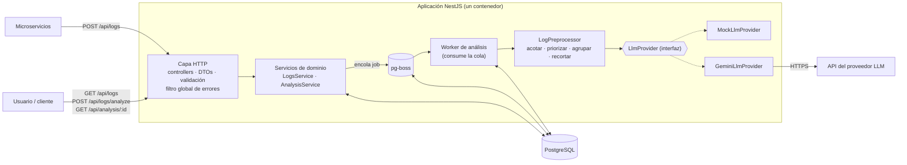
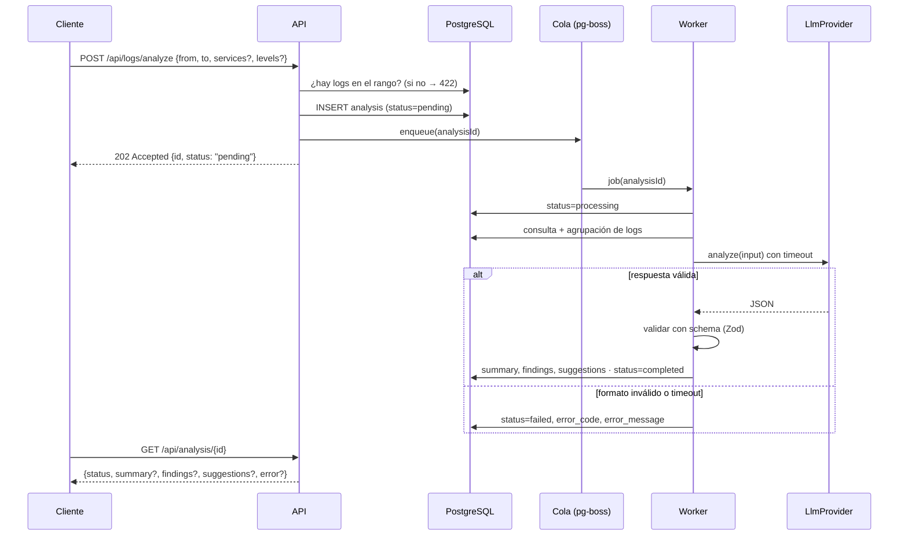
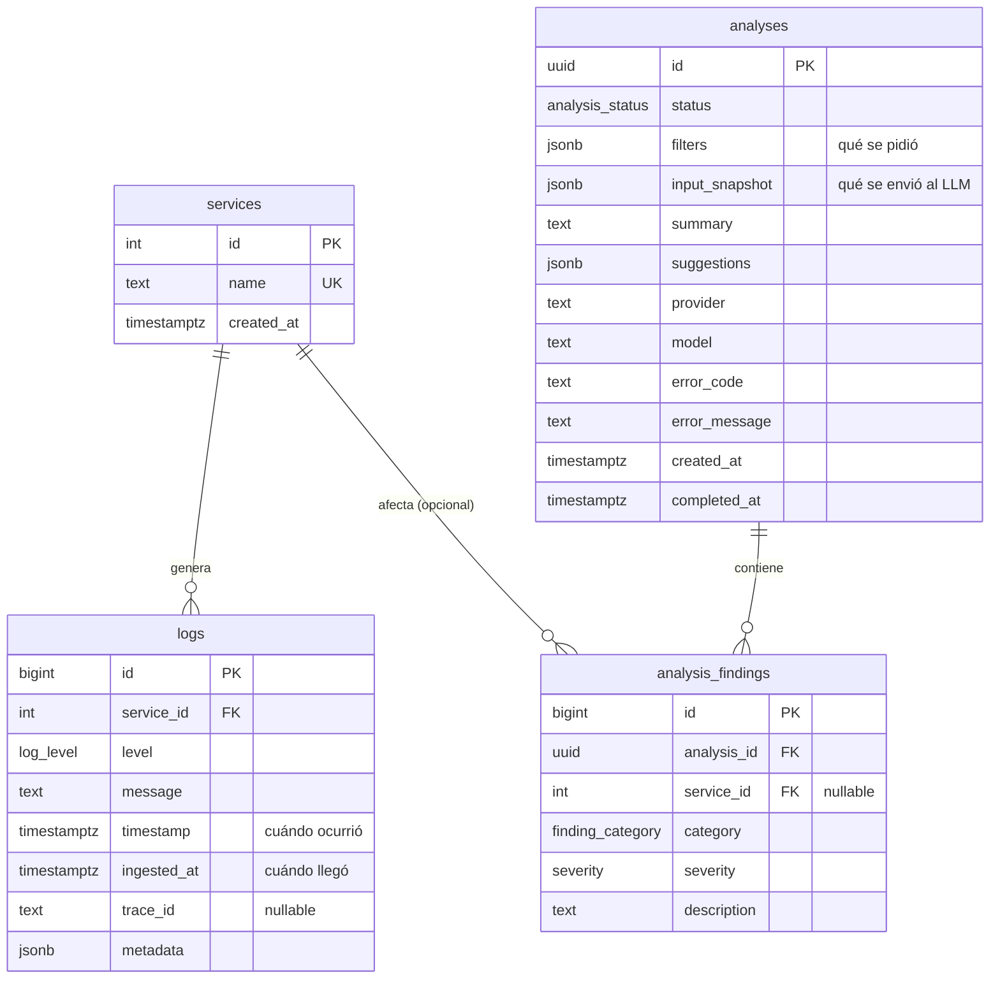

# Arquitectura — SmartLog Analyzer

> Estado: **borrador inicial** (diseño previo al código). Se actualiza a medida que se implementa.

## 1. Problema

Varios microservicios generan logs que hoy se revisan a mano, y se pierden patrones importantes
(por ejemplo, errores que se repiten o que aparecen en un servicio cuando otro se degrada).

SmartLog Analyzer es un prototipo que:

1. **Recibe y almacena** logs de múltiples servicios.
2. **Permite consultarlos** con filtros y agregaciones (por servicio, nivel y rango de fechas).
3. **Analiza un conjunto de logs con un LLM**, que devuelve un resumen en lenguaje natural,
   problemas categorizados y sugerencias de acción, y **persiste cada análisis**.

## 2. Diagrama de componentes

## 3. Flujo del análisis (asíncrono)

El enunciado separa `POST /api/logs/analyze` de `GET /api/analysis/{id}`: el análisis es una
operación larga (segundos, o nunca si el proveedor falla), así que **no se resuelve dentro de la
request HTTP**.

## 4. Preprocesamiento de logs antes del LLM

Mandar logs crudos al LLM es caro, lento y empeora la calidad (la señal se diluye en el ruido).
El `LogPreprocessor` aplica estas etapas:

1. **Acotar**: todo análisis tiene un rango de fechas obligatorio (con un máximo configurable)
   y filtros opcionales por servicio y nivel.
2. **Priorizar**: `FATAL` > `ERROR` > `WARN`. `INFO` y `DEBUG` se excluyen por defecto.
3. **Agrupar**: se normaliza cada mensaje (números, UUIDs, IPs, emails → marcadores) y se agrupa
   por `(servicio, nivel, patrón)` con `count`, `firstSeen`, `lastSeen` y un ejemplo.
4. **Recortar**: tope sobre la cantidad de **patrones** (no de logs) y truncado de mensajes largos.
5. **Contexto**: se agregan estadísticas globales (totales por servicio y nivel) para que el
   LLM conozca la escala aunque no vea todo.
6. **Enmascarar**: los datos sensibles (emails, tokens, números de tarjeta) se reemplazan antes
   de salir del sistema.

Lo que se envió (patrones + estadísticas + si hubo recorte) se guarda en el análisis
(`input_snapshot`) para trazabilidad.

## 5. Modelo de datos

- `log_level`: `DEBUG | INFO | WARN | ERROR | FATAL`
- `analysis_status`: `pending | processing | completed | failed`
- `severity`: `LOW | MEDIUM | HIGH | CRITICAL`
- Índices: `logs(service_id, timestamp)`, `logs(level, timestamp)`, `logs(timestamp)`.

## 6. Decisiones técnicas

Cada decisión incluye la alternativa descartada y el motivo.

| # | Decisión | Alternativa descartada | Motivo |
|---|----------|------------------------|--------|
| 1 | **NestJS + TypeScript** | Fastify puro / Express; Python + FastAPI | Los módulos y la inyección de dependencias de Nest permiten cambiar el `LlmProvider` (real o mock) por configuración y en tests sin tocar el dominio. Express deja toda la estructura a criterio propio. FastAPI es excelente para IA, pero TypeScript es el lenguaje que domino y puedo defender línea por línea. |
| 2 | **PostgreSQL** | MongoDB; Elasticsearch | Las agregaciones por servicio, nivel y fecha son SQL natural (`GROUP BY`, `date_trunc`), y los análisis son relacionales. `JSONB` cubre la metadata variable de los logs. Elasticsearch es la herramienta típica para logs a escala (índice invertido, escala horizontal, retención por ciclo de vida), pero es excesivo para un prototipo y complica el despliegue (ver §8). |
| 3 | **Análisis asíncrono con cola en Postgres (pg-boss)** | Respuesta sincrónica; promesa en memoria; Redis + BullMQ | Una respuesta sincrónica deja la request colgada hasta que responde el LLM. Una promesa en memoria pierde el trabajo si se reinicia el proceso. BullMQ es estándar, pero agrega Redis como infraestructura. pg-boss persiste los jobs en la misma base, con reintentos y sin servicios extra. |
| 4 | **`LlmProvider` como interfaz con mock + proveedor real (Gemini)** | Llamar al SDK del proveedor directo desde el servicio | Permite testear sin red ni costo y cambiar de proveedor por variable de entorno. Gemini tiene capa gratuita. |
| 5 | **Salida estructurada del LLM validada con Zod** | Confiar en el formato; parsear texto libre | Los LLMs devuelven a veces JSON inválido, texto alrededor o valores fuera del enum. La validación convierte esos casos en un `failed` controlado. Se usa Zod porque parsea JSON externo desconocido mejor que los decoradores. |
| 6 | **Agrupar logs en patrones antes del LLM** | Mandar los N logs más recientes | Más información con menos tokens. Un tope fijo de logs puede dejar afuera los errores relevantes (ver §4). |
| 7 | **Prisma como ORM y migraciones** | TypeORM; Drizzle; SQL a mano | Migraciones y seed integrados, con tipos generados. TypeORM tiene sincronización automática peligrosa e historial de bugs. Drizzle es muy bueno y más cercano a SQL, pero tiene menos material de integración con Nest. Las agregaciones por fecha usan SQL crudo tipado (`$queryRaw`). |
| 8 | **Validación HTTP con class-validator (DTOs de Nest)** | Zod también en HTTP | Es el camino idiomático de Nest, se integra con `ValidationPipe` y con Swagger. Zod se reserva para la respuesta del LLM. |
| 9 | **Errores en formato RFC 9457 (Problem Details)** | Formato propio | Es un estándar (`application/problem+json`) y deja respuestas consistentes desde un único filtro global. |
| 10 | **IDs: `bigint` para logs, `uuid` para análisis** | `uuid` en todo | Los logs son alto volumen y se ordenan por inserción. Los análisis se exponen en la URL: un `uuid` no es enumerable. |
| 11 | **Servicios auto-registrados al ingestar (upsert por nombre)** | Registro previo obligatorio | Es más simple para los microservicios. El costo es que un typo crea un servicio nuevo, y se mitiga validando el formato del nombre. |
| 12 | **Rango de fechas obligatorio en `/analyze`** | Analizar "todo" | Acota el costo y el tiempo, y obliga a un análisis con alcance claro. Si no hay logs en el rango se responde 422 sin llamar al LLM. |
| 13 | **`GeminiLlmProvider` con `fetch` nativo de Node** | SDK oficial `@google/genai` | Es una sola llamada HTTP a un endpoint de generación con salida estructurada; `fetch` evita sumar una dependencia nueva, da control total sobre el `AbortController` propio (el SDK maneja timeouts internamente y podría pisar el configurado), y el tipado de la respuesta ya lo cubre el schema Zod compartido con `MockLlmProvider` (decisión #5). |
| 14 | **Defaults de `@nestjs/cli` 12: ESM + Vitest + oxlint** | Pinear una versión anterior de Nest con CommonJS + Jest + ESLint | El CLI oficial, al día de este desafío, genera el proyecto así por defecto. Vitest es compatible con Testcontainers igual que Jest (ambos son solo clientes Node del daemon de Docker), y oxlint cubre las reglas type-aware que necesitamos. Se acepta el riesgo de usar herramientas más nuevas porque vienen mantenidas por el propio equipo de Nest, en vez de fijar manualmente una combinación más vieja contra la corriente del CLI. Se descarta explícitamente `AGENTS.md` y `@nestjs/mau`, generados también por el scaffold: el primero instruye instalar un servicio de telemetría SaaS de terceros no solicitado, el segundo es tooling de deploy propietario que no aplica a este despliegue por Docker. |
| 15 | **Validar solo las env vars que el código consume hoy (`PORT`, `DATABASE_URL`)** | Validar las 8 variables de la tabla de env vars desde el día uno | `LLM_*`/`ANALYSIS_*` todavía no las lee ningún código (quedan para las etapas del LLM y del análisis). Exigirlas en el arranque sería una regla sin efecto real y una fuente de fricción al configurar el entorno antes de necesitarlas. Quedan documentadas en `.env.example` (comentadas) y se agregan a la validación cuando la etapa que las usa se implemente. |
| 16 | **Postgres en Docker (`docker-compose.yml`), la app sigue corriendo local** | Dockerfile + compose completo (app + db) desde ahora | Contenerizar la app ahora obligaría a reconstruir la imagen en cada cambio durante desarrollo activo. Postgres sí se beneficia de Docker porque no cambia entre iteraciones. `DATABASE_URL` usa `localhost` (no `db`) porque la app todavía no está en la misma red de Docker; el Dockerfile multi-stage de la app se retoma más cerca de la entrega, cuando agregarlo no frena la iteración. |
| 17 | **Prisma 7 con adaptador `@prisma/adapter-pg` en vez de `datasource.url`** | Seguir usando `url = env("DATABASE_URL")` en el `datasource` del schema (el patrón de Prisma &lt;7) | A partir de Prisma 7 el motor de queries requiere pasar un *driver adapter* al construir `PrismaClient` (la URL en el `datasource` del schema ya no alcanza; el motor legado de conexión directa fue retirado). La URL de conexión para Migrate vive en `prisma.config.ts` (vía el helper `env()`), y `PrismaService` construye el adaptador (`PrismaPg`) con la `DATABASE_URL` ya validada por `ConfigService`. No es una alternativa descartada por preferencia: es el único camino soportado en la versión estable actual (verificado contra el registro de npm al momento de instalar). |
| 18 | **Reordenar el plan por etapas: infraestructura mínima + CRUD de logs en una sola vuelta** | Seguir las etapas 0–4 del checklist original en orden estricto | La Etapa 1 original pedía que `docker compose up` corriera las migraciones, pero esas migraciones no existían hasta la Etapa 2 (dependencia circular). Se reordenó a pedido del autor: Postgres en Docker + Prisma (schema completo) + validación de entorno + base HTTP (`/api`, `ValidationPipe`, filtro RFC 9457) + `POST`/`GET /api/logs`, todo en una sola vuelta, para tener antes posible algo real para programar y probar. La cola (pg-boss) y el `LlmProvider` quedan igual que antes, para después. Ver la sección "Plan por etapas" de `CLAUDE.md`, actualizada para reflejar este orden. |
| 19 | **Seed de ejemplo adelantado a la Etapa 1, registrado en `prisma.config.ts#migrations.seed`** | Dejarlo para la Etapa 2, como seed "mínimo" (pocos logs a mano) | El enunciado pide explícitamente "scripts de migración y seed con datos de ejemplo que permitan probar la aplicación". Se adelantó `db/seed.ts`: 12 servicios simulando AWS/Azure/GCP/on-prem, ~4800 logs con metadata heterogénea y ráfagas de error, idempotente. Nació como script suelto fuera de git para pruebas manuales; se promovió al repo porque es un requisito explícito, no una mejora interna. Prisma 7 expone `migrations.seed` en `prisma.config.ts` (campo nuevo, verificado contra los tipos instalados de `@prisma/config`), así `prisma migrate dev` lo corre solo y `npm run db:seed` permite re-ejecutarlo. |
| 20 | **`GET /api/logs/stats`: un solo `groupBy` (`service` o `level`), sin bucketing por intervalo todavía** | `groupBy` combinado (servicio + nivel a la vez); agregar `interval` (hora/día) desde el inicio | El enunciado pide "al menos una consulta de agregación, por ejemplo por servicio, nivel o rango de fechas" sin más detalle — es una decisión abierta. Un solo `groupBy` por request cubre los tres ejemplos (servicio, nivel, y `from`/`to` como filtro de rango) con una query simple (`prisma.log.groupBy`) y una respuesta fácil de testear. El bucketing por intervalo (`date_trunc`, vía `$queryRaw`) queda para una vuelta posterior si el tiempo alcanza: agrega valor (series de tiempo) pero no es necesario para cumplir el requisito mínimo. |
| 21 | **Tests e2e: `overrideProvider(PrismaService)` en vez de pisar `process.env.DATABASE_URL`** | Pisar `process.env.DATABASE_URL` en el `beforeAll`, antes de compilar el módulo de test | `ConfigModule.forRoot({ validate })` valida el entorno al *importar* `AppModule`, antes de que cualquier `beforeAll` llegue a correr — pisar la env var ahí nunca tuvo efecto (bug real, detectado al sembrar la base de dev: los tests e2e se conectaban silenciosamente a esa base real en vez de al Postgres efímero de Testcontainers, y solo "pasaban" porque esa base estaba vacía la primera vez). La solución no depende del timing: se reemplaza el provider `PrismaService` por una instancia construida a mano y apuntada al contenedor, vía `Test.createTestingModule(...).overrideProvider(PrismaService).useValue(...)` — el patrón estándar de Nest para este caso. De paso se dieron de baja `AppController`/`AppService` y sus specs: boilerplate de `nest new` nunca adaptado al proyecto real, que enmascaraba parte del problema. |
| 22 | **`@nestjs/swagger` adelantado desde la Etapa 6, con el plugin del CLI en vez de decorar todo a mano** | Documentar la API recién al cierre del proyecto; decorar cada DTO con `@ApiProperty()` manualmente | El autor pidió documentación interactiva tipo Swagger (como Swashbuckle en .NET) para poder probar la API a medida que se suman endpoints, no solo al final. Se usa el plugin oficial del compilador (`nest-cli.json#compilerOptions.plugins`, `classValidatorShim` + `introspectComments`): infiere `@ApiProperty()` de los decoradores de `class-validator` y los tipos de TypeScript ya existentes en los DTOs, sin duplicar esa información a mano. Los parámetros de *query* (`page`/`limit`, `groupBy`/`from`/`to`) sí necesitan `@ApiQuery()` explícito en el controller — el plugin no los infiere porque no hay un `@Body()` de por medio. Servido en `/docs` (fuera del prefijo `/api`, ya que `SwaggerModule.setup()` registra sus rutas directo en el adapter de Express, sin pasar por `setGlobalPrefix`). |
| 23 | **Cola pg-boss: solo infraestructura + test e2e de pickup, sin worker placeholder en el arranque** | Registrar un `.work(ANALYSIS_QUEUE, ...)` "de prueba" en `src/queue/` para verificar el mecanismo a mano | `PgBossService extends PgBoss` (mismo patrón que `PrismaService extends PrismaClient`), con `onModuleInit` haciendo `start()` + `createQueue(ANALYSIS_QUEUE)` (idempotente). Ningún `.work()` se registra en código de la aplicación en esta vuelta — si se dejara un handler "de prueba" ahí y no se borrara al agregar el worker real de la Etapa 4, quedarían dos `.work()` compitiendo por la misma cola en el mismo proceso: pg-boss reparte los jobs entre todos los consumidores registrados, así que una fracción de los análisis reales caería silenciosamente en el handler de prueba, sin ningún error visible. La verificación de "¿un worker toma el job?" queda en `tests/queue.e2e-spec.ts`: un test repetible que registra su propio worker temporal contra un Postgres efímero de Testcontainers (nunca contra la base real) y se descarta al terminar. Siguiendo la decisión #21, el test reemplaza tanto `PrismaService` como `PgBossService` vía `overrideProvider(...).useValue(...)`, para no repetir esa clase de bug con la conexión de la cola. **Actualización (decisión #24)**: `tests/queue.e2e-spec.ts` se dio de baja al implementar el worker real — ver #24. |
| 24 | **Worker real de análisis: `finding_category` libre, errores de dominio sin retry de pg-boss, errores de infraestructura con retry, guard de idempotencia** | `finding_category` como enum cerrado en Zod; dejar que pg-boss reintente también los 3 errores `LLM_*`; no chequear si el `Analysis` ya está resuelto antes de procesar | **Categoría libre**: `category` en el schema Zod es `string` no vacío (no un enum), guiado solo por el prompt con ejemplos — un enum cerrado generaría `LLM_INVALID_RESPONSE` ante categorías razonables que el LLM elija fuera de la lista, y ya es coherente con que `AnalysisFinding.category` en Prisma es `String`. **Errores de dominio vs. infraestructura**: el handler (`AnalysisWorkerService`) atrapa `LlmTimeoutError`/`LlmInvalidResponseError`/`LlmProviderError`, persiste `Analysis.status = failed` con el `errorCode` correspondiente, y **resuelve** (no relanza) — para pg-boss ese job terminó bien, evitando reintentar una llamada al LLM que ya falló de forma controlada. Cualquier otro error (ej. Prisma/Postgres caído) se deja propagar, y ahí sí pg-boss reintenta: `createQueue(ANALYSIS_QUEUE, { retryLimit: 3, retryBackoff: true, expireInSeconds: 60 })` (el default real de pg-boss es `expireInSeconds: 900`; se bajó porque el propio `LLM_TIMEOUT_MS` ya acota el handler muy por debajo de eso, así que solo importa como red de seguridad ante un handler colgado por un bug). **Guard de idempotencia**: el handler relee el `Analysis` al empezar y no hace nada si ya está `completed`/`failed` — cubre el caso de un reintento de pg-boss que llega después de que un intento previo ya escribió el resultado pero el proceso murió antes de confirmarle a pg-boss que el job había terminado, evitando `AnalysisFinding` duplicados. **`tests/queue.e2e-spec.ts` se eliminó**: registraba su propio `.work(ANALYSIS_QUEUE, ...)` de prueba importando `AppModule` completo: al existir ahora `AnalysisWorkerService` (que también se registra sobre `ANALYSIS_QUEUE` al bootear la app), ese test quedaba compitiendo con el worker real por los mismos jobs — exactamente el escenario de doble consumidor que la decisión #23 había anticipado y que ahora, con el worker real ya implementado, quedó resuelto por el propio `tests/analysis.e2e-spec.ts` (que prueba el pickup real end-to-end, incluyendo un caso de reintento tras una falla transitoria). |

| 25 | **`GeminiLlmProvider`: `responseSchema` escrito a mano, auth por header, timeout propio con `AbortSignal.timeout`, errores del proveedor sin retry de pg-boss (reafirma #24)** | Derivar el `responseSchema` de Gemini con `z.toJSONSchema(analysisResultSchema)` (ya disponible en la instalación de Zod v4); autenticar con `?key=` en la URL; confiar solo en el timeout del worker, sin `AbortController` propio en el provider | **`responseSchema` a mano**: se probó `z.toJSONSchema()` contra `analysisResultSchema` y su salida usa convenciones de JSON Schema estándar (`anyOf` para nullable, `additionalProperties: false`, `exclusiveMinimum`, `$schema`) que el subset tipo-OpenAPI-3.0 que acepta Gemini no soporta (nada de `anyOf`/`$ref`/`additionalProperties`) — pasarle esa salida tal cual arriesga un 400 o que ignore restricciones en silencio. Se escribe `GEMINI_RESPONSE_SCHEMA` a mano en `gemini-llm-provider.ts`, espejo campo a campo de `analysisResultSchema`, aceptando esa duplicación menor como trade-off consciente (el contrato es chico y estable). **Auth por header `x-goog-api-key`**: nunca `?key=` en la URL, para que la key no quede en ningún log/URL — coherente con la postura de privacidad de §7. **Timeout propio**: el worker ya envuelve `analyze()` en su propio timeout (`withTimeout`), pero eso solo hace que el worker deje de esperar, no cancela el `fetch` en curso — por eso `GeminiLlmProvider` usa `AbortSignal.timeout(timeoutMs)` (Node 26, soportado nativamente) para cancelar la llamada HTTP real, tal como ya anticipaba la decisión #13. **Errores del proveedor sin retry**: todo lo que puede fallar en `analyze()` (red caída, HTTP no-2xx, timeout/abort, contenido bloqueado por Gemini, JSON malformado en la respuesta) se normaliza a uno de los 3 `LlmError` ya existentes — nada escapa sin envolver — porque, por la decisión #24, cualquier error que el worker no reconozca como uno de esos 3 tipos dispara el reintento nativo de pg-boss; una falla de Gemini escapando sin envolver activaría ese reintento por accidente, contradiciendo que las 3 fallas `LLM_*` ya son un resultado de negocio terminal (incluye fallas del proveedor, no solo errores de formato). **Hallazgo real durante la implementación**: el modelo `gemini-2.5-flash` (el default documentado hasta ahora) ya no está disponible para API keys nuevas — Google lo retiró a favor de `gemini-3.8-flash`/`gemini-3.5-flash-lite`. Se verificó en vivo contra la API real (no se asumió) y se cambió el default a `gemini-3.5-flash-lite`, que respondió correctamente con salida estructurada. La capa gratuita de ese modelo mostró latencia variable (de ~1s a >20s para el mismo tipo de pedido) — `LLM_TIMEOUT_MS` sigue en `20000` como default de código (razonable para un tier de producción más estable), pero en desarrollo con la capa gratuita puede valer subirlo localmente. |
| 26 | **`GET /api/logs`: `service` case-insensitive, `search` vía `ILIKE` sin índice dedicado** | `service` exacto (`equals` case-sensitive); `search` con un índice `pg_trgm`/GIN desde ahora | El enunciado pide el endpoint "con filtros" sin especificar cuáles — se usa el set ya documentado antes en `CLAUDE.md` (`service`, `level`, `from`, `to`, `search`). **`service` case-insensitive** (`{ name: { equals, mode: 'insensitive' } }`): `Service.name` es una unique key case-sensitive asignada por upsert exacto al ingestar (decisión #11), pero forzar al caller de un *filtro de listado* a replicar esa casing exacta sería una trampa de usabilidad sin beneficio — es un problema distinto del de la ingesta, que si necesita ser exacta para no duplicar servicios. **`search` vía `contains` + `mode: 'insensitive'`** sobre `message` (compila a `ILIKE` en Postgres): no hay ningún índice que lo respalde, ni ningún uso de `ILIKE`/full-text en el resto del proyecto. Es aceptable a esta escala de prototipo (ver §8) — un índice `pg_trgm`/GIN, o directamente mover la búsqueda libre a Elasticsearch, quedan para producción. De paso, `?search=` vacío se rechaza con 400 (`@MinLength(1)`) en vez de interpretarse como "sin filtro", porque un substring vacío matchearía todo en silencio — probablemente un bug del cliente, no una intención real. |
| 27 | **`GET /api/health` con `@nestjs/terminus` + `PrismaHealthIndicator`, verificando solo Postgres** | Health check "tonto" (siempre `200 OK`, sin tocar dependencias); escribir el ping a mano con `prisma.$queryRaw`; chequear también pg-boss por separado | Terminus ya trae `PrismaHealthIndicator` (hace un `$queryRawUnsafe('SELECT 1')` con timeout propio de 1s) — no hace falta escribirlo a mano. Un chequeo que siempre devuelve `200` no cumple el propósito real del endpoint ("verificar el estado del servicio" según el enunciado): orquestadores/balanceadores lo usan para decidir si reiniciar o sacar de rotación una instancia, y necesitan saber si la dependencia crítica (la base) responde. No se agrega un indicador separado para pg-boss: corre sobre la misma conexión a Postgres que ya chequea `PrismaHealthIndicator` (decisión #3), así que un indicador aparte sería redundante — si Postgres está caído, ambos lo están. Terminus devuelve `200` con el detalle de cada indicador si todos responden, o lanza `ServiceUnavailableException(result)` (**503**) con el mismo detalle si alguno falla. Ese resultado no trae un campo `message`/`error` como el resto de las excepciones HTTP del proyecto, así que `ProblemDetailsFilter` se extendió con un caso para reconocer esa forma (`status` + `details`) y listar en `errors` qué indicador falló y por qué — para no perder esa información al envolverla en el mismo formato RFC 9457 (`application/problem+json`) que ya usa el resto de la API, en vez de darle a este endpoint un formato de error aparte solo porque sus consumidores son infra en vez de un cliente HTTP típico. |

## 7. Seguridad y robustez

- **Logs como datos no confiables**: se delimitan en el prompt como datos, nunca como instrucciones
  (mitiga prompt injection). La respuesta del LLM siempre se valida antes de persistirse.
- **Datos sensibles** enmascarados antes de enviar a un proveedor externo.
- **Timeout** configurable en la llamada al LLM (`AbortController`) y reintento acotado del job.
- **Secretos** solo por variables de entorno. `.env.example` sin valores reales.

## 8. Qué cambiaría en producción

- Ingesta y búsqueda de logs en **Elasticsearch / OpenSearch** (o el stack de logs existente de la
  empresa, como Loki o Datadog), dejando esta herramienta como capa de análisis con IA encima.
  Postgres quedaría solo para los análisis.
- Antes de eso: **particionar `logs` por fecha** y definir una política de retención.
- Ingesta por lotes y asíncrona (por ejemplo, con Kafka) en lugar de un POST por log.
- Para volúmenes grandes, un análisis **map-reduce**: resumir por bloques y después resumir los
  resúmenes.
- Autenticación entre servicios (API keys o mTLS) y rate limiting en la ingesta.
- **`GET /api/logs`: paginación por cursor (`id`/`timestamp`) en vez de `page`/`limit` por
  offset.** Hoy usa `skip`/`take` (decisión consciente para este prototipo: simple, permite pedir
  "página N" directo, y el volumen es manejable). A escala real tiene dos problemas: `OFFSET`
  grande obliga a Postgres a recorrer y descartar todas las filas anteriores antes de la página
  pedida (cada vez más lento cuanto más atrás se pagina), y si se insertan logs nuevos mientras se
  pagina, las filas se corren y se puede repetir o saltear un registro. Cursor pagination
  (`WHERE id < :cursor ORDER BY id DESC LIMIT :limit`) resuelve ambos — usa el índice directo sin
  importar cuán "atrás" se pagina, y el cursor es un valor estable, no una posición relativa. El
  costo es no poder saltar directo a una página arbitraria, aceptable para un caso de uso de
  scroll hacia atrás en el tiempo como este.
- **Test de volumen/concurrencia para la cola (`src/queue/`).** `tests/analysis.e2e-spec.ts`
  prueba que el worker real toma un job y lo procesa (incluyendo un caso de reintento), pero no
  prueba carga: cientos de jobs en paralelo, varios workers compitiendo (`teamSize`/`batchSize` de
  pg-boss), verificando que cada job se procesa exactamente una vez (sin duplicados, gracias al
  `SKIP LOCKED` que usa pg-boss internamente) y midiendo throughput. Se dejó afuera a propósito: no
  lo pide el enunciado, y un test así metería carga/dependencias extra (nada de herramientas de
  load testing como k6 — se podría armar liviano, con Vitest, pocos cientos de jobs con payloads
  chicos y concurrencia vía las opciones nativas de pg-boss) que no aporta a lo que el desafío
  evalúa.
- **Notificar la finalización de un análisis en vez de solo exponer `GET /api/analysis/:id` para
  polling.** El enunciado solo pide ese endpoint, y el polling ya cubre el caso de uso mínimo — pero
  dado que esta API la consume típicamente otro servicio (no una persona mirando una pantalla), el
  complemento natural sería un **webhook**: una `callbackUrl` opcional en el body de
  `POST /api/logs/analyze`, a la que `AnalysisWorkerService` le hace un `POST` con el resultado
  (`completed` o `failed`) apenas termina de persistirlo, con su propia política de reintentos de
  entrega (independiente de la del job en pg-boss) y protección contra SSRF (no debería poder
  apuntar a una red/servicio interno). Se consideraron también SSE/WebSocket (un stream por
  `analysisId`) para un caso de uso más interactivo, pero agregan estado y complejidad de
  pub/sub entre instancias que no se justifican para un consumidor que es otro backend, no un
  browser.
- **Índice para `search` en `GET /api/logs`.** Hoy filtra `message` con `ILIKE` (vía `contains` +
  `mode: 'insensitive'` de Prisma) sin ningún índice que lo respalde — a este volumen de prototipo
  barre la tabla completa cuando se combina con filtros que no acotan mucho primero (ver decisión
  #26). En producción, un índice `pg_trgm`/GIN sobre `message` serviría para volúmenes medios, o
  directamente mover la búsqueda libre a Elasticsearch/OpenSearch (ya contemplado más arriba en
  esta sección para los logs en general).
- **`GET /api/health`: separar *liveness* de *readiness*, y chequear el LLM.** Hoy es un solo
  chequeo (Postgres, vía decisión #27) que mezcla ambos sentidos: "¿el proceso está vivo?" y "¿puede
  atender tráfico de verdad?". A escala de producción conviene separarlos (`/health/live` sin
  dependencias, para que el orquestador no reinicie el pod en un pico de latencia de la base;
  `/health/ready` con Postgres y, opcionalmente, un ping liviano al proveedor de LLM configurado)
  para que cada uno dispare la acción correcta (reiniciar vs. sacar de rotación). No se implementó
  para este desafío porque el enunciado pide un único `GET /api/health`.
